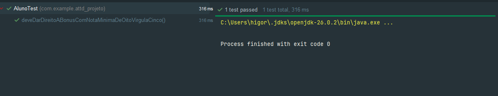
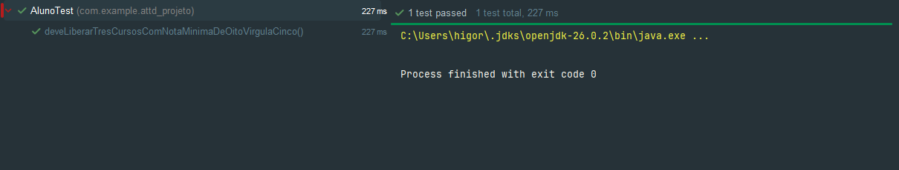
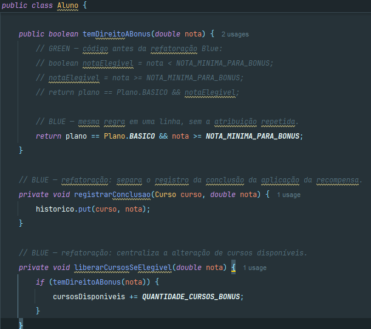

# Plataforma de cursos — DevOps e QA

Projeto acadêmico desenvolvido por **Gabriel Baldi e Higor Aranda**. A implementação parte de uma regra de recompensa da AC1 e evolui, no B1 Architecture Lab, para módulos de negócio, integrações resilientes e implantação por componente.

**Tecnologias:** Java 17 · Spring Boot 4.1.1 · Maven · JUnit · JaCoCo · Python/FastAPI · MQTT/Mosquitto · Jenkins · Prometheus · Grafana.

[Entrega B1 em Word](docs/entrega/B1_Architecture_Lab_Final.docx) · [Decisões arquiteturais](docs/arquitetura/README.md) · [Capturas diretas](docs/evidencias/b1/telas-reais/README.md) · [Infraestrutura local](infra/README.md)

## SkillPath AI · Fundação da AF

A Avaliação Final evolui o projeto com classificação de competências, acompanhamento de treinamentos, recomendações com RAG e ações de orientação sob autorização do aluno. A Fase 01 prepara os contratos, a navegação e o gateway HTTP. As rotas `/api/af` respondem `503 AF_EM_PREPARACAO` enquanto as implementações individuais estão em preparação.

[Roteiro e divisão do trabalho](docs/af/ROADMAP.md) · [Requisitos](docs/af/REQUIREMENTS.md) · [Contratos](docs/af/CONTRACTS.md) · [Arquitetura proposta](docs/af/ARCHITECTURE.md) · [Baseline](docs/af/BASELINE.md)

## Regra de negócio

Um aluno do plano **Básico** recebe **três cursos de bônus** ao concluir um curso com nota **maior ou igual a 8,5**. A conclusão fica no histórico. Notas abaixo desse limite e alunos Premium não recebem esse bônus.

> Como aluno do plano básico, quero ganhar três cursos ao concluir um curso com nota mínima 8,5 para continuar estudando sem pagar mais por isso.

User Story escrita por Gabriel Baldi. O cenário de nota 8,5 foi detalhado por Gabriel Baldi; o de nota 7,0, por Higor Aranda.

| Cenário | Resultado esperado |
| --- | --- |
| Básico, nota 8,5 | Registrar a conclusão e conceder três cursos |
| Básico, nota 7,0 | Registrar a conclusão sem conceder bônus |
| Premium | Preservar a conclusão sem aplicar o bônus do plano Básico |
| Nota inválida | Rejeitar a entrada sem alterar o estado do aluno |

## Arquitetura do B1

O Core continua sendo um único executável Spring Boot. Cursos, ranking e gamificação têm fronteiras internas; a IA e as integrações são processos Python separados.

| Desafio | Solução adotada | Decisão |
| --- | --- | --- |
| 1 — Evolução do Core | Monólito modular e APIs públicas entre capacidades | [ADR-001](docs/adr/ADR-001.md) |
| 2 — Organização interna | Política em Java puro e caso de uso com Ports & Adapters | [ADR-002](docs/adr/ADR-002.md) |
| 3 — Python e IA | HTTP/JSON, timeout e fallback | [ADR-003](docs/adr/ADR-003.md) |
| 4 — Comunicação e eventos | Outbox transacional e entrega eventual | [ADR-004](docs/adr/ADR-004.md) |
| 5 — IoT | MQTT QoS 1, spool persistente e inbox idempotente | [ADR-005](docs/adr/ADR-005.md) |
| 6 — Operação | Pipelines por executável e observabilidade | [ADR-006](docs/adr/ADR-006.md) |

Os diagramas C4 e a matriz de ASRs estão no [registro arquitetural](docs/arquitetura/README.md). Os experimentos verificam se a conclusão e a recompensa continuam funcionando durante as falhas provocadas.

## Estrutura do projeto

```text
src/main/java/com/example/devops/
├── curso/          API, aplicação, domínio e persistência de cursos
├── ranking/        Consulta de ranking pela API pública de alunos
├── gamificacao/    Política de bônus, caso de uso, porta e adapter JPA
├── aluno/api/      Contrato público de leitura para o ranking
├── integracao/     IA, outbox, notificações e inbox de eventos IoT
└── ...             Controllers, entidades e serviços preservados da AC1

services/
├── ia/             Recomendação e assistente demonstrativos
└── integracoes/    Receptor de notificações e gateway MQTT

infra/              Configurações de Jenkins, MQTT e observabilidade
scripts/b1/         Execução, implantação, parada e experimentos locais
docs/               ADRs, diagramas, evidências e documentos de entrega
```

## Executar localmente

### Core e testes

O Core tem alvo Java 17 e usa o Maven Wrapper do projeto. O ambiente completo validado no laboratório é Windows, com JDK 25 para executar o Jenkins.

```powershell
.\mvnw.cmd clean verify
```

Para executar somente o Core com o perfil local:

```powershell
.\mvnw.cmd spring-boot:run '-Dspring-boot.run.profiles=lab'
```

Esse perfil usa H2 em arquivo. Encerre o processo com `Ctrl+C` quando terminar. Sem os serviços Python, o Core mantém o fallback da IA e conserva notificações pendentes até o receptor voltar.

### Laboratório com os componentes preparados

Os comandos abaixo usam ferramentas locais e artefatos previamente aprovados em `infra/.runtime/last-good`. A preparação inicial e os requisitos estão no [guia da infraestrutura](infra/README.md).

```powershell
.\scripts\b1\infra-start.ps1
.\scripts\b1\infra-deploy.ps1 -Component core -Artifacts '.\infra\.runtime\last-good\core'
.\scripts\b1\infra-deploy.ps1 -Component ia -Artifacts '.\infra\.runtime\last-good\ia'
.\scripts\b1\infra-deploy.ps1 -Component integracoes -Artifacts '.\infra\.runtime\last-good\integracoes'
```

| Ferramenta | Endereço local |
| --- | --- |
| Swagger do Core | http://127.0.0.1:8080/swagger-ui/index.html |
| Saúde do Core | http://127.0.0.1:8080/actuator/health |
| Documentação da IA | http://127.0.0.1:8001/docs |
| Documentação das integrações | http://127.0.0.1:8002/docs |
| Jenkins | http://127.0.0.1:8081 |
| Prometheus | http://127.0.0.1:9090 |
| Grafana | http://127.0.0.1:3000/d/b1-operacao |
| MQTT | `127.0.0.1:1883`, tópico `b1/atividades` |

Para encerrar os componentes iniciados pelos scripts:

```powershell
.\scripts\b1\infra-component-stop.ps1 -Component core
.\scripts\b1\infra-component-stop.ps1 -Component ia
.\scripts\b1\infra-component-stop.ps1 -Component integracoes
.\scripts\b1\infra-stop.ps1
```

### Alternativa com Docker

O Compose raiz configura PostgreSQL, o Core, o gateway e os serviços de IA, notificações e MQTT do B1. Use o gateway em `http://127.0.0.1:8088` e o Swagger em `http://127.0.0.1:8088/swagger-ui.html`.

```powershell
docker compose up --build
docker compose down
```

As portas diretas `8080` e `5432` do Compose anterior continuam publicadas para compatibilidade com o laboratório. O MQTT usa rede interna. Para publicar um evento de teste, use o cliente `mosquitto_pub` dentro do contêiner `mqtt`. Consulte a [baseline da AF](docs/af/BASELINE.md) para os limites da validação Docker.

## API

| Método | Endpoint | Função |
| --- | --- | --- |
| POST / GET | `/api/alunos` | Criar ou listar alunos |
| GET | `/api/alunos/{id}` | Consultar o estado de um aluno |
| POST / GET | `/api/cursos` | Criar ou listar cursos |
| POST | `/api/alunos/{id}/concluir-curso` | Registrar a conclusão e aplicar a política de bônus |
| GET | `/api/ranking` | Consultar a pontuação derivada do histórico |
| GET | `/api/alunos/{id}/recomendacoes` | Consultar recomendações ou fallback |
| POST | `/api/assistente` | Consultar o assistente demonstrativo |
| GET | `/api/notificacoes/pendentes` | Consultar a quantidade de eventos pendentes |
| POST | `/api/iot/eventos` | Receber evento IoT de forma idempotente |

Exemplo de conclusão de curso:

```json
{ "cursoId": 1, "nota": 8.5 }
```

O contrato completo está no Swagger e em `/v3/api-docs`.

## Testes e evidências

| Verificação registrada | Resultado |
| --- | --- |
| Java — domínio, casos de uso e integrações | 80 testes aprovados |
| JaCoCo — 38 classes medidas | 100% de linhas, branches e instruções |
| Python — IA, integrações e runner | 19 testes aprovados na execução original |
| E2E — desafios 3, 4 e 5 | 36 verificações aprovadas na execução original |

O `clean verify` executa os testes, gera `target/site/jacoco/index.html` e aplica o gate de cobertura por classe. Teste reprovado ou cobertura insuficiente interrompe o build. O relatório HTML padrão dos testes pode ser gerado com:

```powershell
.\mvnw.cmd surefire-report:report-only
```

O arquivo fica em `target/reports/surefire.html`. Para os testes Python, com as dependências dos dois serviços instaladas no ambiente local:

```powershell
services/ia/.venv/Scripts/python.exe -m pytest services/ia/tests services/integracoes/tests scripts/b1/tests -q
```

As [capturas diretas](docs/evidencias/b1/telas-reais/README.md) identificam as ferramentas, os cenários e os arquivos brutos de apoio. Os [registros originais](docs/evidencias/b1/README.md) conservam os logs, JSONs e relatórios das primeiras execuções.

<details>
<summary><strong>Histórico da AC1 — BDD, TDD e integração com H2</strong></summary>

### RED

Testes falhando antes da implementação da regra:


### GREEN

Implementação e aprovação dos cenários:






### Refatoração e persistência




</details>

## Limites do laboratório

A execução comprovada usa processos Windows nativos, H2 em arquivo no Core e SQLite nas integrações. Docker, PostgreSQL e implantação em nuvem não foram executados. A IA usa recomendação determinística e busca textual local, sem treinamento de ML ou RAG/LLM completo. Também não houve ensaio de carga para 100 mil usuários.

Os próximos passos são medir capacidade, ampliar falhas e concorrência, definir objetivos de operação e avaliar a qualidade dos recursos de IA.
