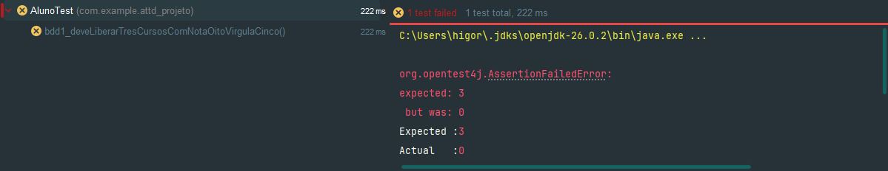
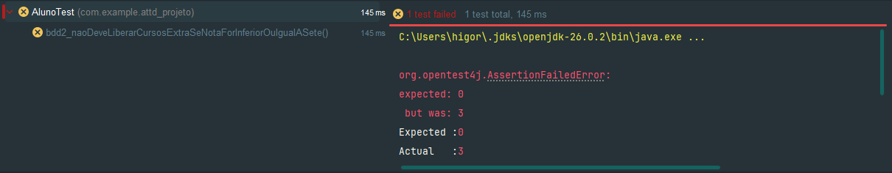
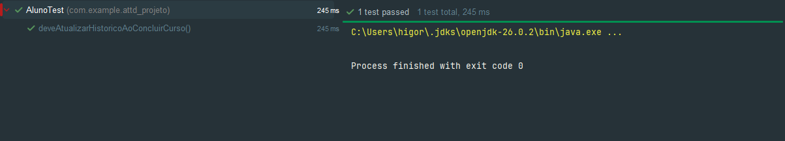
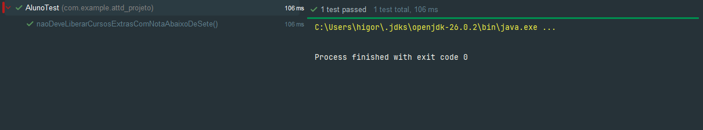
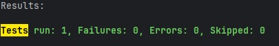

# Projeto DevOps

## Sobre o caso

O caso fala de uma plataforma de cursos online por assinatura. O aluno do plano básico paga uma mensalidade e tem acesso a cursos. Quando termina um curso com uma nota boa, ele ganha mais cursos. O aluno também pode ganhar curso participando do fórum. Depois de conquistar 12 cursos, passa para o plano Premium e ganha outras vantagens.

Neste projeto, foi escolhida a parte em que o aluno do plano básico ganha 3 cursos quando tira nota maior ou igual a 8,5.

## User Story escolhida

**Quem escreveu: Gabriel Baldi**

> Como aluno do plano básico, quero ganhar 3 cursos quando terminar um curso com nota maior ou igual a 8,5 para continuar estudando sem pagar mais por isso.

## BDDs feitos

### BDD 1 - Gabriel Baldi

João é aluno do plano básico e termina um curso com nota 8,5. A nota precisa ficar no histórico e ele deve ganhar 3 cursos.

### BDD 2 - Higor Aranda

Maria é aluna do plano básico e termina um curso com nota 7,0. Ela não deve ganhar cursos extras.

## TDD

### RED

No RED os testes falham porque a regra ainda não estava pronta.

**BDD 1 falhando**



**BDD 2 falhando**



### GREEN

No GREEN a regra foi implementada e os testes passaram.

**BDD 1 - testes passando**




**BDD 2 - testes passando**





### BLUE

No BLUE o código foi organizado sem mudar o resultado dos testes. A cobertura da regra original ficou em 100%, sem partes em vermelho ou amarelo.


## Organização do projeto

O projeto está separado assim:

- `controller`: recebe as requisições da API;
- `service`: aplica as regras;
- `repository`: conversa com o banco;
- `domain`: classes `Aluno`, `Curso` e `Plano`;
- `dto`: dados que entram e saem da API.

## Swagger

Com a aplicação rodando, abra:

```text
http://localhost:8080/swagger-ui.html
```

O JSON da documentação fica em:

```text
http://localhost:8080/v3/api-docs
```

## Endpoints

| Método | Endpoint | O que faz |
| --- | --- | --- |
| POST | `/api/alunos` | Cria um aluno |
| GET | `/api/alunos` | Lista alunos |
| GET | `/api/alunos/{id}` | Busca um aluno |
| POST | `/api/cursos` | Cria um curso |
| GET | `/api/cursos` | Lista cursos |
| POST | `/api/alunos/{id}/concluir-curso` | Conclui um curso e verifica o bônus |

Exemplo para criar aluno:

```json
{ "nome": "João", "plano": "BASICO" }
```

Exemplo para criar curso:

```json
{ "nome": "Docker" }
```

Exemplo para concluir curso:

```json
{ "cursoId": 1, "nota": 8.5 }
```

## Banco de dados

### H2

Foi feito um teste de integração usando H2 em memória. Ele cria aluno e curso, salva a conclusão e verifica os 3 cursos de bônus.

Resultado: teste executado com sucesso, 0 falhas e 0 erros.



### PostgreSQL

O PostgreSQL está configurado no `docker-compose.yml`. O banco criado é o `devops_db` e a porta é `5432`.

Depois de subir o Docker, estes comandos mostram a evidência:

```powershell
docker compose ps
docker compose logs db
```

## Rodando com Docker

Abra o terminal dentro da pasta `DEVOPS` e rode:

```powershell
docker compose up --build
```

Depois abra o Swagger em `http://localhost:8080/swagger-ui.html`.

Para parar tudo:

```powershell
docker compose down -v
```

## Rodando os testes

Com Java 17 ou superior:

```powershell
.\mvnw.cmd clean verify
```

O comando executa os testes de domínio e de integração da API com H2, gera o
relatório JaCoCo e exige 100% de cobertura de linhas, branches e instruções em
cada classe. Se a cobertura ficar abaixo disso ou algum teste falhar, o build falha.

Abra `target/site/jacoco/index.html` no navegador para consultar o relatório.
Os testes verificam os limites de nota, o plano Premium, entradas inválidas,
histórico e média, persistência, criação e consulta pela API e respostas 400/404.

## B1 Architecture Lab

Os seis desafios evoluem este MVP com módulos de curso e ranking, política de
bônus isolada, serviço Python demonstrativo, outbox de notificações, integração
MQTT idempotente e pipelines Jenkins com Prometheus/Grafana.

O laboratório foi executado com processos Windows nativos e banco H2 em arquivo.
PostgreSQL/Docker permanecem como alternativa configurada, sem comprovação de
execução em containers. A regra original do bônus de três cursos a partir de
nota 8,5 foi preservada. A IA é demonstrativa, sem modelo ML/RAG completo.

- [Registro arquitetural, matriz de ASRs e seis ADRs](docs/arquitetura/README.md)
- [Resultados reais e 18 capturas](docs/evidencias/b1/README.md)
- [Documento Word com respostas e evidências por desafio](docs/entrega/B1_Architecture_Lab_Resolvido.docx)
- [Preparação e execução da infraestrutura local](infra/README.md)

- [Especificação e decisões propostas](docs/superpowers/specs/2026-11-03-b1-design.md)
- [Plano de implementação e critérios de conclusão](docs/superpowers/plans/2026-11-03-b1-architecture-lab.md)
- [Guia de prints com nomes, telas e pastas de destino](docs/evidencias/b1/README.md)

Verificação executada: 80 testes Java aprovados, com 100% de cobertura de linhas,
branches e instruções por classe; 19 testes Python aprovados. Os experimentos
reais dos Desafios 3, 4 e 5 aprovaram 36 verificações de integração.

Para repetir os experimentos depois de iniciar a infraestrutura e implantar os
três componentes conforme o guia:

```powershell
services/ia/.venv/Scripts/python.exe -m pytest services/ia/tests services/integracoes/tests scripts/b1/tests -q
services/ia/.venv/Scripts/python.exe scripts/b1/laboratorio.py --execute
.\scripts\b1\infra-metrics.ps1
```

O roteiro usa dados sintéticos novos, provoca indisponibilidade temporária e
restaura os componentes a partir do último artefato aprovado. As evidências
registram datas, respostas, identificadores e hashes dos fontes efetivamente
executados. A entrega no GitHub deve usar a branch do B1; a cópia interna
`DevOPs/` não faz parte desta implementação.
