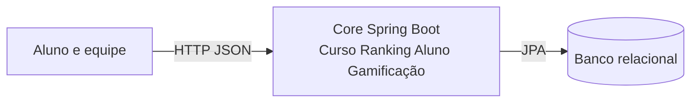

# ADR-001 — Drivers e evolução do Core

Estado: decisão implementada; resultados e limites vinculados nas evidências de execução.

## Contexto e requisitos

RF01 Ranking; RF02 Conquistas e funcionalidades da AC1.

Manutenibilidade, desempenho, escalabilidade, testabilidade e complexidade operacional.

## ASRs prioritários

1. **Manutenibilidade:** Agrupar curso e ranking por capacidade localiza alterações e explicita fronteiras.
2. **Testabilidade:** Preservar contratos HTTP e testar o comportamento antes/depois permite reorganização incremental.
3. **Complexidade operacional:** Manter um processo Core e banco relacional evita infraestrutura distribuída sem evidência de necessidade.

## Restrições e premissas

Core Java/Spring Boot, legado AC1, banco relacional e equipe de seis desenvolvedores no cenário. A equipe real identificada no repositório tem Gabriel Baldi e Higor Aranda.

## Alternativas e trade offs

- **Monólito em camadas:** Mudança inicial pequena; capacidades permanecem espalhadas por pastas técnicas.
- **Monólito modular:** Maior coesão e fronteiras explícitas; exige disciplina de dependências e ainda escala o Core inteiro.
- **Serviço seletivo de ranking:** Permite deploy/escala independentes; acrescenta rede, sincronização de dados e operação sem demanda medida neste experimento.

## Decisão

Modularizar incrementalmente curso e ranking dentro do Core. Ranking lê alunos pela API pública do serviço, sem importar seu repositório. Preservar contratos de cursos e alunos.

## Consequências e limites

Não há escala independente dos módulos. Ranking usa 100 pontos por entrada distinta no histórico e desempate por ID; não foram introduzidas moedas. Consulta atual é didática e não certifica desempenho para 100 mil usuários.

## C4 e evidência

[Diagrama fonte](../arquitetura/diagramas/core.mmd)

Snapshot original, árvore reorganizada, imports antes/depois, consulta ao ranking e regressão automatizada.

[Resultados de execução](../evidencias/b1/desafio-01/README.md)
