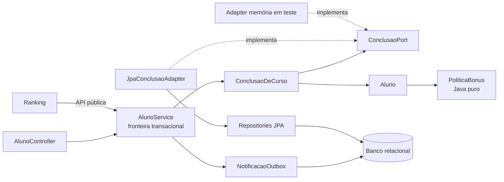

# ADR-002 — Organização interna do Core

Estado: decisão implementada; resultados e limites vinculados nas evidências de execução.

## Contexto e requisitos

RF02 Conquistas e recompensa por conclusão; RF01 Ranking como leitura do resultado.

Manutenibilidade, testabilidade, modificabilidade e facilidade de evolução.

## ASRs prioritários

1. **Testabilidade:** A política de bônus deve rodar sem contexto Spring nem acesso ao banco.
2. **Modificabilidade:** O caso de conclusão depende de uma porta de dados com adapters substituíveis.
3. **Manutenibilidade:** Uma única política concentra o limite de nota e a quantidade de bônus.

## Restrições e premissas

Core permanece Spring Boot, regras existentes reaproveitadas e refatoração localizada. Básico com nota ≥ 8,5 recebe três cursos; Premium não recebe esse bônus.

## Alternativas e trade offs

- **Estrutura atual:** Simples e já testada; acesso JPA e orquestração ficam juntos no serviço.
- **Ports & Adapters localizado:** Caso de uso e regra testáveis com memória/JPA; acrescenta uma porta e adapter, sem reescrever todas as entidades.

## Decisão

Extrair PoliticaBonus em Java puro e ConclusaoDeCurso dependente de ConclusaoPort. Usar JpaConclusaoAdapter no Core e adapter em memória nos testes.

## Consequências e limites

As entidades legadas ainda possuem anotações JPA; a proteção é aplicada à política e ao caso de uso selecionados. DDD organiza os conceitos; Hexagonal organiza dependências. Clean/Onion podem compartilhar esse princípio, mas não exigem quatro estruturas simultâneas.

## C4 e evidência

[Diagrama fonte](../arquitetura/diagramas/component.mmd)

Teste puro da política, contrato de conclusão em memória e integração JPA/H2, limites de nota e relatório de cobertura.

[Resultados de execução](../evidencias/b1/desafio-02/README.md)
