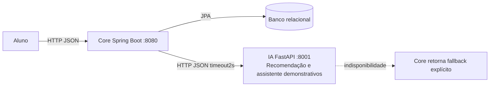

# ADR-003 — Serviço Python e IA

Estado: decisão implementada; resultados e limites vinculados nas evidências de execução.

## Contexto e requisitos

RF03 Recomendação inteligente; RF04 Assistente educacional, em microsolução demonstrativa.

Deploy independente, escalabilidade, tolerância a falhas, interoperabilidade, desempenho e manutenibilidade.

## ASRs prioritários

1. **Tolerância a falhas:** Timeout e resposta degradada impedem que a IA indisponível bloqueie o Core.
2. **Deploy independente:** Processo Python próprio permite atualizar a implementação sem reiniciar o Java.
3. **Interoperabilidade:** Contrato HTTP/JSON mantém a fronteira entre Java e Python explícita.

## Restrições e premissas

Core Java/Spring Boot, IA em Python, fluxo essencial disponível sem IA. Usuário escolheu laboratório local sem provedor pago.

## Alternativas e trade offs

- **IA embutida no Core:** Menos processos; ciclo de modelos e execução ficam acoplados ao Java.
- **Módulo acoplado:** Localiza a capacidade, mas não oferece isolamento de processo ou deploy.
- **FastAPI independente:** Fronteira e deploy próprios; exige contratos, timeout e tratamento de indisponibilidade.

## Decisão

Um FastAPI atende recomendação e assistente demonstrativos. O Core chama por HTTP com timeout de dois segundos e sem retentativa na thread do usuário. Falha retorna HTTP 200 com disponivel=false e fallback explícito.

## Consequências e limites

Python sozinho não prova necessidade de serviço; autonomia de ciclo e isolamento de falha justificam a fronteira aqui testada. ML/RAG compartilham o executável enquanto não há evidência de cargas/ciclos distintos. A recomendação é determinística e o assistente faz busca textual em material local, sem treinamento de ML ou RAG/LLM completo.

## C4 e evidência

[Diagrama fonte](../arquitetura/diagramas/ai.mmd)

Requisições com IA ativa, IA parada e conclusão de curso mantendo recompensa e histórico.

[Resultados de execução](../evidencias/b1/desafio-03/README.md)
