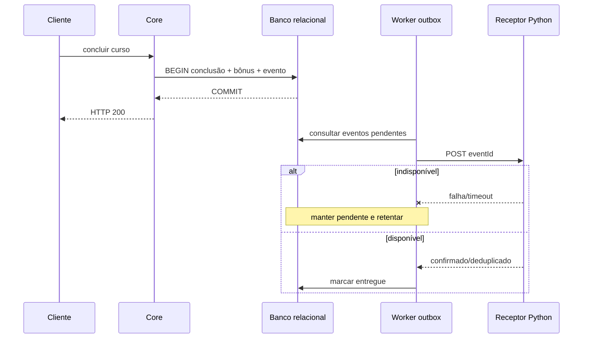

# ADR-004 — Comunicação e eventos

Estado: decisão implementada; resultados e limites vinculados nas evidências de execução.

## Contexto e requisitos

RF02 Conquistas; RF05 Notificações após conclusão.

Tolerância a falhas, disponibilidade, latência, consistência, desacoplamento e recuperabilidade.

## ASRs prioritários

1. **Tolerância a falhas:** Falha do receptor não deve impedir confirmar conclusão e bônus.
2. **Consistência:** Estado essencial e evento pendente são gravados na mesma transação; notificação é eventual.
3. **Recuperabilidade:** Eventos pendentes e identificadores estáveis permitem retentar após indisponibilidade.

## Restrições e premissas

Core precisa concluir com consumidor externo indisponível; broker dedicado implica custo operacional. Processamento único de outbox no laboratório.

## Alternativas e trade offs

- **REST síncrono:** Resposta imediata do receptor; falha e latência propagam-se à chamada dependente.
- **Outbox e worker HTTP:** Usa o banco relacional existente e entrega eventual; exige polling, retentativa e deduplicação.
- **RabbitMQ ou Kafka:** RabbitMQ agrega filas/roteamento e acknowledgements; Kafka agrega log/replay e grupos. Ambos exigem operação adicional sem necessidade de throughput ou replay demonstrada neste caso.

## Decisão

Conclusão e outbox na mesma transação. Worker HTTP a cada cinco segundos, timeout de dois segundos e retentativa com o mesmo eventId. Receptor Python persiste deduplicação em SQLite.

## Consequências e limites

Entrega pelo menos uma vez, com deduplicação no receptor; não há exatamente uma vez distribuído. Confirmação da notificação é eventual. Polling acrescenta latência e o dispatcher do laboratório é de instância única. Dados relacionais do laboratório ficam em H2 arquivo; configuração PostgreSQL permanece para Compose.

## C4 e evidência

[Diagrama fonte](../arquitetura/diagramas/sequence.mmd)

Falha síncrona provocada, conclusão HTTP 200 com evento pendente, recuperação e entrega do mesmo identificador.

[Resultados de execução](../evidencias/b1/desafio-04/README.md)
