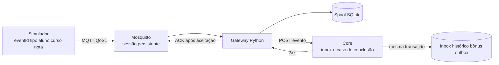

# ADR-005 — IoT e MQTT

Estado: decisão implementada; resultados e limites vinculados nas evidências de execução.

## Contexto e requisitos

RF06 Receber presença, início e conclusão de atividade por dispositivo simulado.

Interoperabilidade, eficiência, disponibilidade, tolerância à conexão intermitente, escalabilidade e segurança de integração.

## ASRs prioritários

1. **Interoperabilidade:** Gateway traduz o evento do dispositivo para contrato HTTP do Core.
2. **Eficiência de comunicação:** MQTT pub/sub evita acoplamento HTTP de cada dispositivo ao Core.
3. **Tolerância à conexão intermitente:** Sessão persistente, QoS 1 e inbox idempotente permitem reconexão e retransmissão.

## Restrições e premissas

Dispositivo pode ter poucos recursos e conexão instável; broker e gateway acrescentam operação. Laboratório usa dados sintéticos e conexões restritas ao loopback.

## Alternativas e trade offs

- **REST direto:** Menos componentes; cada dispositivo precisa conhecer a integração e suas falhas HTTP.
- **MQTT com gateway:** Sessões e pub/sub adequados ao cenário; exige broker, política de entrega e deduplicação.
- **MQTT e broker interno adicional:** Útil para múltiplos consumidores e replay conforme ASRs; neste laboratório duplicaria infraestrutura sem necessidade comprovada.

## Decisão

Mosquitto com persistência e QoS 1 no tópico b1/atividades. Gateway Python mantém spool SQLite e confirma MQTT depois da aceitação HTTP. Core grava eventId e efeito de negócio atomicamente; retransmissão retorna sucesso sem repetir bônus.

## Consequências e limites

QoS 1 admite duplicatas e não substitui idempotência. O experimento prova a janela de desconexão/reconexão executada, não ausência absoluta de perdas em qualquer falha de disco. O gateway compartilha executável de integrações para reduzir operação, com responsabilidades separadas no código.

## C4 e evidência

[Diagrama fonte](../arquitetura/diagramas/iot.mmd)

Publicação/recepção com mesmo ID, publicação com gateway offline, reconexão e retransmissão sem nova recompensa.

[Resultados de execução](../evidencias/b1/desafio-05/README.md)
