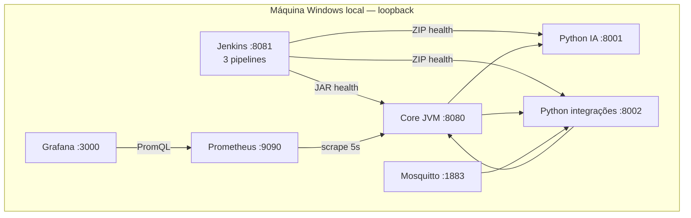

# ADR-006 — CI CD e observabilidade

Estado: decisão implementada; resultados e limites vinculados nas evidências de execução.

## Contexto e requisitos

RF01 a RF06: construção, implantação e observação dos componentes executados.

Observabilidade, deploy independente, confiabilidade, testabilidade, recuperabilidade e desempenho.

## ASRs prioritários

1. **Testabilidade:** Pipeline executa testes e a política de cobertura antes de disponibilizar artefato.
2. **Observabilidade:** Métricas e logs mostram efeito da falha e da recuperação sobre os fluxos essenciais.
3. **Deploy independente:** Jobs por executável atualizam somente Core, IA ou integrações.

## Restrições e premissas

Jenkins é a esteira; Prometheus/Grafana são obrigatórios; configurações e evidências versionadas. Ambiente sem engine Docker disponível.

## Alternativas e trade offs

- **Pipeline único:** Visão centralizada e configuração inicial menor; mudanças independentes ficam acopladas à mesma execução.
- **Pipeline por executável:** Validação e deploy independentes; duplica parte da configuração e requer contratos entre componentes.

## Decisão

Três pipelines Jenkins com teste, build e deploy nativo local. Falha em teste impede build/deploy. Prometheus coleta o Core a cada cinco segundos; Grafana exibe falhas da IA, pendências de notificação e métricas HTTP.

## Consequências e limites

A prova foi desenhada para processos Windows portáveis, com JAR/ZIP e health check. Dockerfiles/Compose são alternativa fornecida, sem alegar execução de containers. O laboratório usa H2 relacional em arquivo; não comprova operação PostgreSQL nem escala. Métrica técnica vira evidência arquitetural quando a parada/recuperação mostra preservação do Core e drenagem da outbox.

## C4 e evidência

[Diagrama fonte](../arquitetura/diagramas/deployment.mmd)

Builds reais de três jobs, teste falho controlado bloqueando deploy, dashboard durante falha/recuperação e consultas Prometheus.

[Resultados de execução](../evidencias/b1/desafio-06/README.md)
