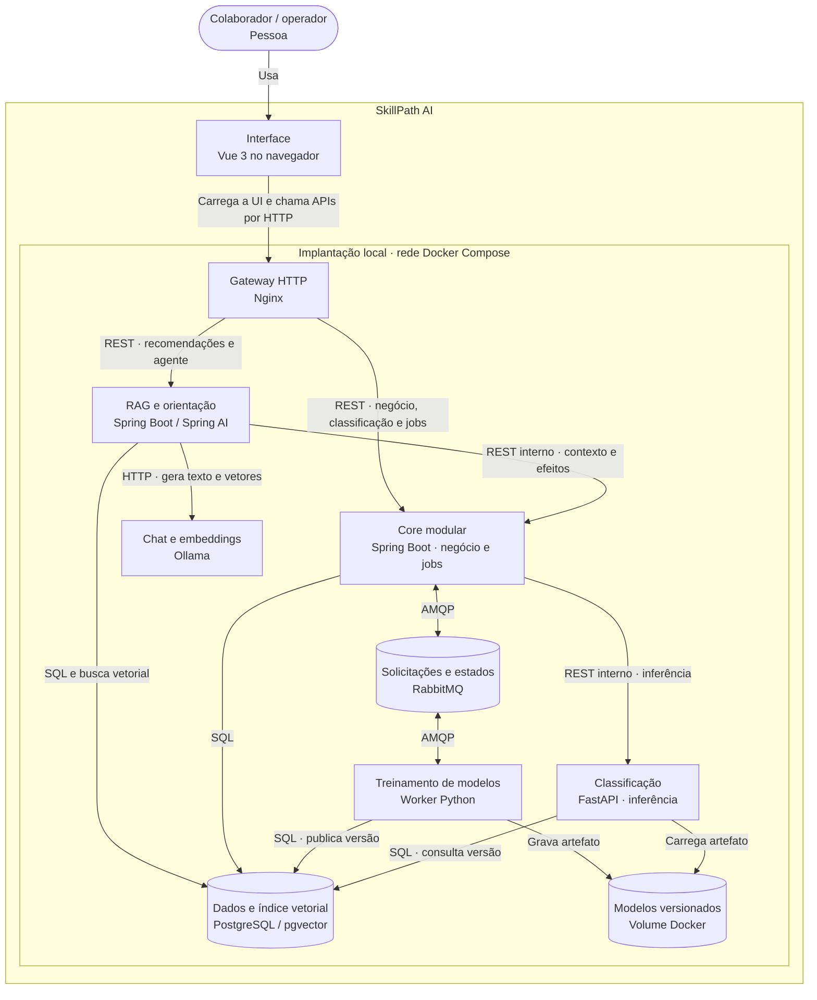

# SkillPath AI — arquitetura proposta

A [decisão principal](../adr/ADR-007.md) mantém o Core Spring Boot como monólito modular de negócio. Spring AI fica em um executável independente para RAG e orientação. FastAPI atende inferência e compartilha código e imagem com um worker dedicado ao treinamento. O processo de treino pode consumir CPU e memória por mais tempo e tem ciclo de falha diferente das consultas HTTP.

O Core mantém alunos, cursos, histórico, gamificação e ranking. Os módulos AF de competências e treinamentos ficam no Core, que valida o aluno, controla acesso e persiste o estado público dos jobs. Spring AI se responsabiliza por recuperação de documentos, geração fundamentada, planejamento e auditoria de autorizações. O Core valida e aplica os efeitos de negócio autorizados. Cada serviço usa APIs ou eventos para acessar dados de outra capacidade.

## C4 nível 2 — contêineres da proposta

**Limites de implantação.** O navegador executa o Vue. O gateway é a entrada HTTP e encaminha a interface servida pelo Core. O Compose atual mantém as portas diretas históricas de Core e PostgreSQL para compatibilidade local. A proposta final as move para configuração opcional de desenvolvimento e separa credenciais por serviço. Os volumes de PostgreSQL, RabbitMQ, modelos e Ollama têm ciclos de vida independentes dos contêineres.

A rede também hospeda os contêineres legados `ia`, `integracoes` e `mqtt`. O Core consulta IA demonstrativa por REST e envia notificações via outbox HTTP. A integração recebe MQTT do Mosquitto, grava o spool em SQLite e entrega eventos ao Core. O [C4 do B1](../arquitetura/README.md#c4-final-container) detalha o legado preservado. Jenkins, Prometheus e Grafana seguem no [laboratório B1](../../infra/README.md). Na integração final, as ferramentas operacionais usam perfis opcionais e coletam métricas pela rede Compose.

## Comunicação

| Interação | Escolha | Justificativa |
| --- | --- | --- |
| Navegador e serviços da AF | REST por meio do Nginx | Contrato uniforme para validação, consulta, confirmação de ação e erros. |
| Core e FastAPI de inferência | REST interno com prazo total e concorrência limitada | A classificação precisa fazer parte da resposta imediata. O Core limita espera e preserva o fluxo de cadastros. |
| Spring AI, Core e provedor | REST interno | A autorização e o catálogo dependem de estado atual. A geração e a busca recebem orçamento de tempo próprio. |
| Solicitação e mudanças de estado de treinamento | RabbitMQ, outbox e consumidores idempotentes | Treinamento tem duração variável. O Core confirma a gravação local e disponibiliza o status para consulta enquanto a entrega se recupera. |
| Notificações e dispositivos B1 | Outbox HTTP e MQTT existentes | Os fluxos anteriores conservam os protocolos e a política de falhas já adotados. |

## Três ASRs prioritários

- **RNF01, latência de classificação.** Separar inferência e treino, manter modelo carregado e limitar filas e prazo de inferência. Medir ponta a ponta com 300 usuários simultâneos e meta de 95% em até 2 s.
- **RNF02, aceitação durante falhas.** Gravar job e outbox na mesma transação do Core. Recuperar publicação e consumo após a volta do broker ou do worker, mantendo o status consultável.
- **RNF03, segurança e privacidade.** Validar identidade e escopos nos serviços, filtrar contexto pelo titular, vincular cada aprovação a uma ação imutável e restringir o agente a ferramentas permitidas. Usar dados sintéticos e corpus permitido na demonstração.

## Execução com um comando na entrega final

1. Preservar o Core, o gateway e os serviços B1 do Compose raiz. Integrar `spring-ai`, `ml`, `ml-worker`, `rabbitmq`, `ollama` e a inicialização dos modelos no conjunto padrão, com imagens e dependências versionadas.
2. Fixar a versão do PostgreSQL com suporte a pgvector e manter o major do volume inicial ou prever migração documentada e ensaiada. Aplicar migrações e conceder papéis por esquema. Usar um conjunto de documentos sintéticos ou autorizados e um modelo inicial de inferência versionado para disponibilizar o fluxo antes do primeiro treino.
3. Publicar os assets Vue no build da imagem do Core. A tela atual carrega Vue de CDN. Servir essa dependência na mesma origem remove a necessidade de rede externa no navegador.
4. Configurar a inicialização automática dos modelos Ollama em volume, com downloads versionados na primeira execução e reuso nos próximos boots. Selecionar provedor e modelos por configuração. Manter cadastro e consulta disponíveis enquanto modelos são carregados ou recursos de IA estão indisponíveis.
5. Amarrar dependências rígidas a health checks, incluindo PostgreSQL, com timeout e retentativa nos clientes. Tratar dependências de IA e mensageria de forma independente da inicialização do Core. Usar apenas as portas públicas previstas, com acesso interno para banco, broker, modelos e operações de serviço.
6. Validar `docker compose up --build` em checkout limpo com Docker Engine, sem processos auxiliares no host nem chaves pagas. Registrar primeira inicialização, chamadas completas, parada e recuperação de serviços, persistência após reinício e `docker compose down`.

[Ordem de inicialização do Compose](https://docs.docker.com/compose/how-tos/startup-order/) · [Spring AI com Ollama](https://docs.spring.io/spring-ai/reference/api/embeddings/ollama-embeddings.html) · [Confirmações do RabbitMQ](https://www.rabbitmq.com/docs/confirms)
