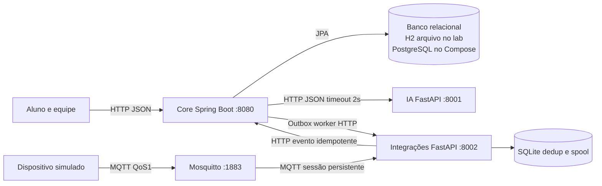
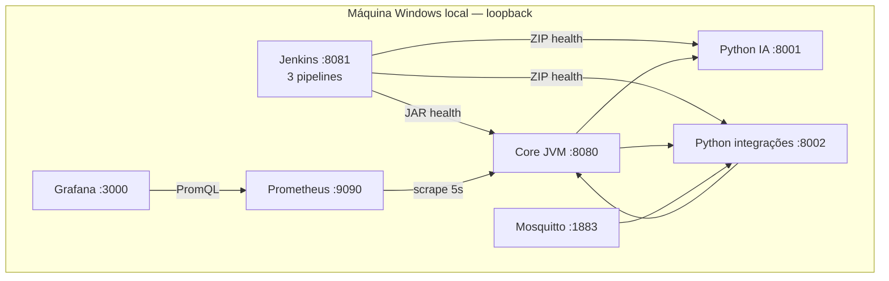

# Registro arquitetural do B1

Equipe: Gabriel Baldi e Higor Aranda, conforme identificação existente no README da AC1.

Repositório: https://github.com/GabrielBGS04/DevOPs

Base histórica do laboratório: `bdb6943`, registrada em 03/11/2026. A [entrega final](../entrega/B1_Architecture_Lab_Final.docx) reúne respostas e diagramas; o [índice de capturas diretas](../evidencias/b1/telas-reais/README.md) documenta as telas e os resultados observados. Esta referência histórica não descreve o estado atual do repositório.

## Objetivo e execução

Os seis desafios evoluem o mesmo MVP. Cada ADR relaciona RF/RNF, até três ASRs, restrições, alternativas, decisão, C4 e evidência. O laboratório usa dados sintéticos e processos nativos locais; os limites de IA, escala, Docker e PostgreSQL estão explícitos nas decisões.

## Requisitos e FURPS

RF01 ranking; RF02 conquistas/recompensa; RF03 recomendação; RF04 assistente; RF05 notificação; RF06 IoT. A regra existente concede três cursos ao plano básico com nota mínima de 8,5.

RNFs: confiabilidade/tolerância e recuperabilidade (R); desempenho/latência/throughput (P); suporte, manutenibilidade, testabilidade e observabilidade (S); protocolos e implantação nas restrições adicionais (+). Os ASRs abaixo são um subconjunto dos RNFs analisados em cada desafio.

## Matriz cumulativa de ASRs

| Identificador | Desafio | Qualidade | Impacto arquitetural | Decisão |
| --- | --- | --- | --- | --- |
| D1-ASR1 | 1 | Manutenibilidade | Agrupar curso e ranking por capacidade localiza alterações e explicita fronteiras. | [ADR-001](../adr/ADR-001.md) |
| D1-ASR2 | 1 | Testabilidade | Preservar contratos HTTP e testar o comportamento antes/depois permite reorganização incremental. | [ADR-001](../adr/ADR-001.md) |
| D1-ASR3 | 1 | Complexidade operacional | Manter um processo Core e banco relacional evita infraestrutura distribuída sem evidência de necessidade. | [ADR-001](../adr/ADR-001.md) |
| D2-ASR1 | 2 | Testabilidade | A política de bônus deve rodar sem contexto Spring nem acesso ao banco. | [ADR-002](../adr/ADR-002.md) |
| D2-ASR2 | 2 | Modificabilidade | O caso de conclusão depende de uma porta de dados com adapters substituíveis. | [ADR-002](../adr/ADR-002.md) |
| D2-ASR3 | 2 | Manutenibilidade | Uma única política concentra o limite de nota e a quantidade de bônus. | [ADR-002](../adr/ADR-002.md) |
| D3-ASR1 | 3 | Tolerância a falhas | Timeout e resposta degradada impedem que a IA indisponível bloqueie o Core. | [ADR-003](../adr/ADR-003.md) |
| D3-ASR2 | 3 | Deploy independente | Processo Python próprio permite atualizar a implementação sem reiniciar o Java. | [ADR-003](../adr/ADR-003.md) |
| D3-ASR3 | 3 | Interoperabilidade | Contrato HTTP/JSON mantém a fronteira entre Java e Python explícita. | [ADR-003](../adr/ADR-003.md) |
| D4-ASR1 | 4 | Tolerância a falhas | Falha do receptor não deve impedir confirmar conclusão e bônus. | [ADR-004](../adr/ADR-004.md) |
| D4-ASR2 | 4 | Consistência | Estado essencial e evento pendente são gravados na mesma transação; notificação é eventual. | [ADR-004](../adr/ADR-004.md) |
| D4-ASR3 | 4 | Recuperabilidade | Eventos pendentes e identificadores estáveis permitem retentar após indisponibilidade. | [ADR-004](../adr/ADR-004.md) |
| D5-ASR1 | 5 | Interoperabilidade | Gateway traduz o evento do dispositivo para contrato HTTP do Core. | [ADR-005](../adr/ADR-005.md) |
| D5-ASR2 | 5 | Eficiência de comunicação | MQTT pub/sub evita acoplamento HTTP de cada dispositivo ao Core. | [ADR-005](../adr/ADR-005.md) |
| D5-ASR3 | 5 | Tolerância à conexão intermitente | Sessão persistente, QoS 1 e inbox idempotente permitem reconexão e retransmissão. | [ADR-005](../adr/ADR-005.md) |
| D6-ASR1 | 6 | Testabilidade | Pipeline executa testes e a política de cobertura antes de disponibilizar artefato. | [ADR-006](../adr/ADR-006.md) |
| D6-ASR2 | 6 | Observabilidade | Métricas e logs mostram efeito da falha e da recuperação sobre os fluxos essenciais. | [ADR-006](../adr/ADR-006.md) |
| D6-ASR3 | 6 | Deploy independente | Jobs por executável atualizam somente Core, IA ou integrações. | [ADR-006](../adr/ADR-006.md) |

## Decisões e evidências

- Desafio 1: [Drivers e evolução do Core](../adr/ADR-001.md) — [evidências](../evidencias/b1/desafio-01/README.md).
- Desafio 2: [Organização interna do Core](../adr/ADR-002.md) — [evidências](../evidencias/b1/desafio-02/README.md).
- Desafio 3: [Serviço Python e IA](../adr/ADR-003.md) — [evidências](../evidencias/b1/desafio-03/README.md).
- Desafio 4: [Comunicação e eventos](../adr/ADR-004.md) — [evidências](../evidencias/b1/desafio-04/README.md).
- Desafio 5: [IoT e MQTT](../adr/ADR-005.md) — [evidências](../evidencias/b1/desafio-05/README.md).
- Desafio 6: [CI CD e observabilidade](../adr/ADR-006.md) — [evidências](../evidencias/b1/desafio-06/README.md).

## C4 final Container

## C4 final Deployment

## Síntese para a Avaliação Final

Levar para a PoC: módulos incrementais no Core, política de bônus pura, porta de persistência, isolamento HTTP da IA com fallback, outbox transacional, inbox idempotente e métricas ligadas aos experimentos. Manter um único serviço demonstrativo de IA enquanto não houver evidência para separar ML/RAG.

Aprofundar antes de produção: carga real e consulta paginada do ranking; modelo/recuperação RAG reais; autenticação e integração por instituição; operação PostgreSQL e containers; retenção/limpeza da outbox e políticas de retry; múltiplos workers; segurança MQTT fora do loopback; backup e continuidade. O cenário de 100 mil usuários não foi certificado pelos pequenos experimentos.

## Reprodução

Consultar [infraestrutura](../../infra/README.md), [roteiro de comprovação](../evidencias/b1/README.md) e os comandos registrados nos resultados dos desafios. O [documento Word final](../entrega/B1_Architecture_Lab_Final.docx) está disponível na pasta de entrega.
