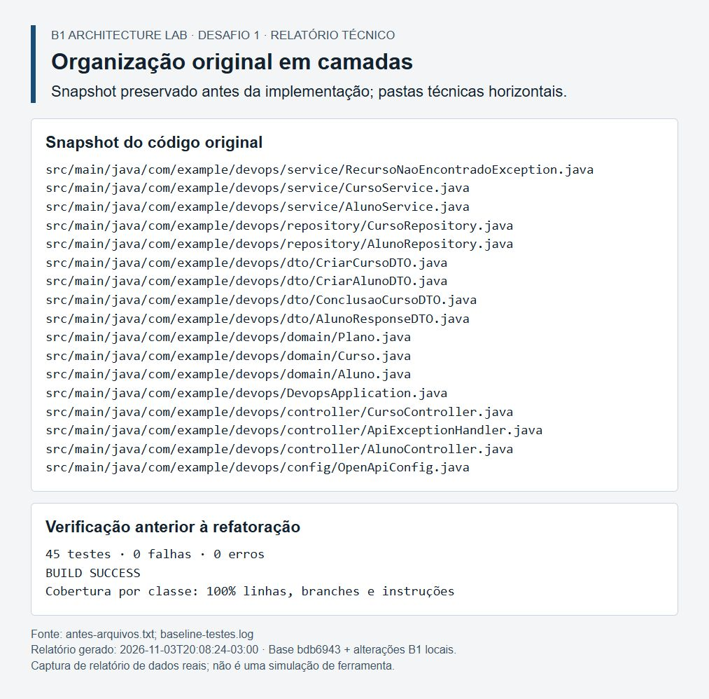
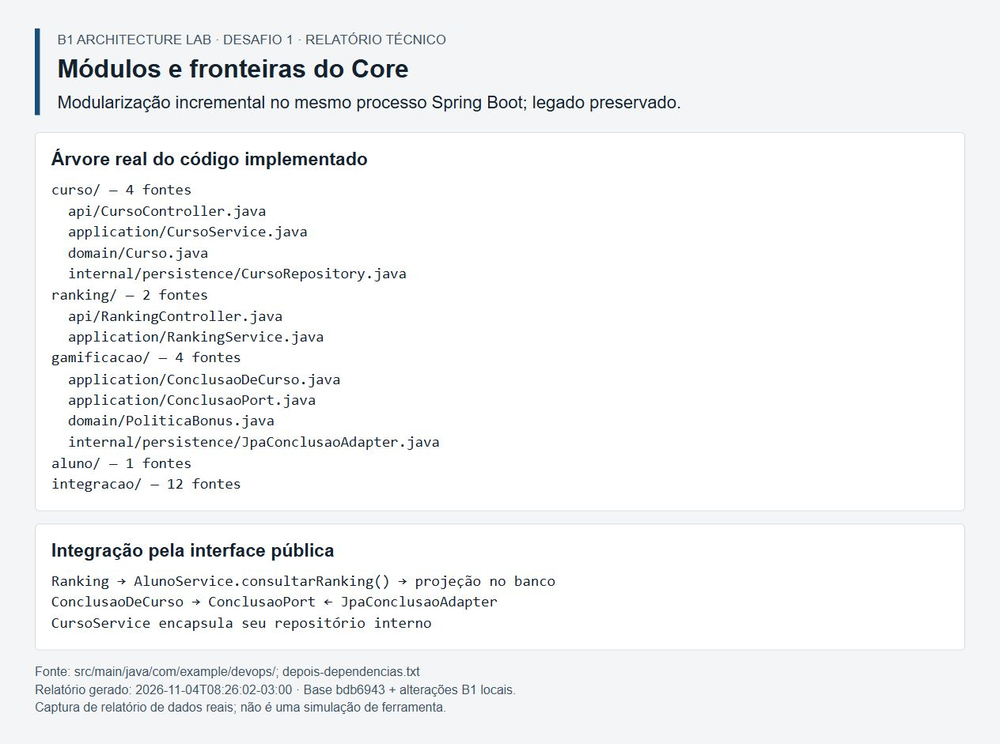
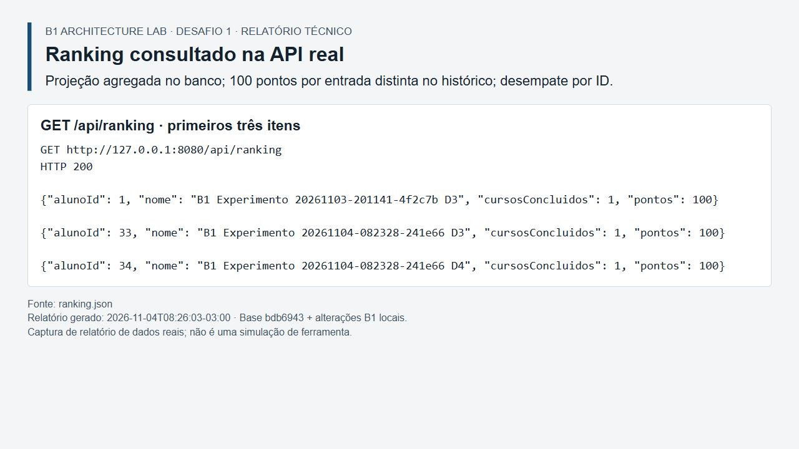

# Evidências do Desafio 1 — Drivers e evolução do Core

**Estado:** IMPLEMENTADO, EXPERIMENTO EXECUTADO E CAPTURAS SALVAS.

## Hipótese arquitetural

Snapshot original, árvore reorganizada, imports antes/depois, consulta ao ranking e regressão automatizada.

## Execução observada

Baseline executado em 03/11/2026: 45 testes aprovados. Verificação final da implementação: 80 testes e cobertura de 100% por classe; ranking consultado após os experimentos de 04/11/2026.

Snapshot em camadas preservado; curso e ranking agrupados por capacidade; ranking HTTP 200 com pontuação e ordem verificadas; regressão sem falhas.

Base Git: `bdb6943`, branch local `codex/b1-architecture-lab`, com alterações B1 no momento da execução. Os JSONs dos experimentos e os artefatos do Jenkins registram hashes dos fontes para identificar a implementação efetivamente testada.

## Capturas reais

### 01-camadas-antes.jpg

Captura: 2026-11-03T20:09:21.250432-03:00. SHA-256: `1612f7e52fff5a0bac948064502b8ecae85850af08700a80cec5e3ca4469f83a`.

### 02-modulos-depois.jpg

Captura: 2026-11-04T08:26:53.223422-03:00. SHA-256: `f83065cda64241350af15cc5f505e8a8f5f2ff5c733e01511b9531b104873298`.

### 03-ranking-funcionando.jpg

Captura: 2026-11-04T08:26:53.436484-03:00. SHA-256: `d35d7cd17b21e018b6217a175b54f55827d0b749b006d58bb16fe189ee2ea00e`.

## Fontes e reprodução

[Baseline](baseline-testes.log), [RED](red-b1.log), [imports antes](antes-dependencias.txt), [imports depois](depois-dependencias.txt), [resposta real do ranking](ranking.json), [verificação final](../desafio-02/verify-final.log).

[Guia de captura e reprodução](../README.md)

[ADR-001](../../../adr/ADR-001.md) · [C4 fonte](../../../arquitetura/diagramas/core.mmd)

## Limites

Não há escala independente dos módulos. Ranking usa 100 pontos por entrada distinta no histórico e desempate por ID; não foram introduzidas moedas. Consulta atual é didática e não certifica desempenho para 100 mil usuários.

Os prints dos Desafios 1 a 5 mostram relatórios de dados reais preservados em texto/JSON; não simulam interface de terminal, Swagger ou IDE. Os prints do Desafio 6 mostram Jenkins e Grafana diretamente.
