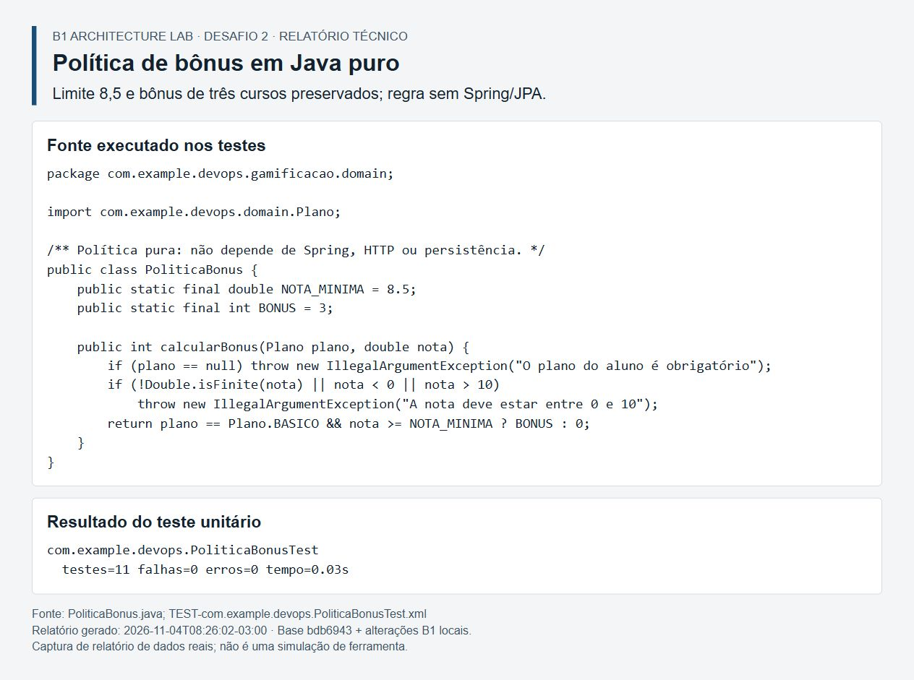
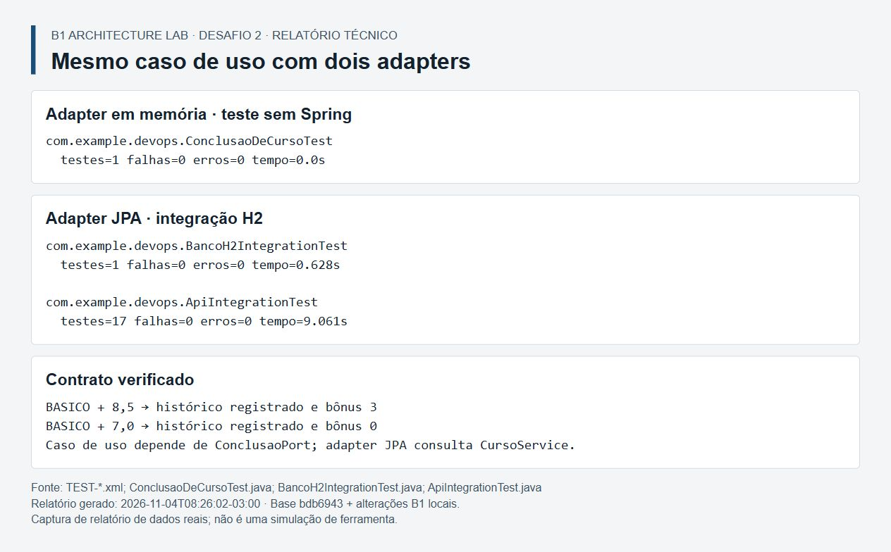
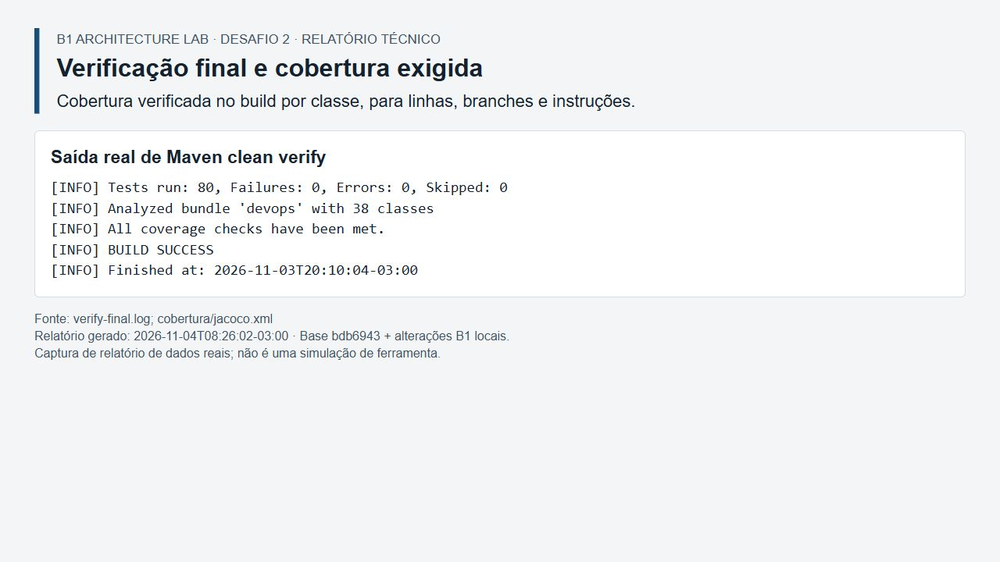

# Evidências do Desafio 2 — Organização interna do Core

**Estado:** IMPLEMENTADO, EXPERIMENTO EXECUTADO E CAPTURAS SALVAS.

## Hipótese arquitetural

Teste puro da política, contrato de conclusão em memória e integração JPA/H2, limites de nota e relatório de cobertura.

## Execução observada

Verificação `mvnw.cmd clean verify` concluída em 03/11/2026; logs e relatórios preservados. A refatoração mantém as entidades legadas JPA e isola a regra/caso de uso selecionados.

80 testes Java aprovados; 38 classes com 100% de linhas, branches e instruções. Política pura em teste sem Spring; adapter em memória e JPA/H2 preservam histórico e bônus.

Base Git: `bdb6943`, branch local `codex/b1-architecture-lab`, com alterações B1 no momento da execução. Os JSONs dos experimentos e os artefatos do Jenkins registram hashes dos fontes para identificar a implementação efetivamente testada.

## Capturas reais

### 01-regra-isolada.jpg

Captura: 2026-11-04T08:26:53.657633-03:00. SHA-256: `36eb56c93042f809435723a69c1169d3fd2bec80076167eb571f6f448a8e999c`.

### 02-adapters-testados.jpg

Captura: 2026-11-04T08:26:55.032343-03:00. SHA-256: `6632ec4b2e0f7c016950d4ddfc62449d1021985d4a46bd9092a6e11d75979970`.

### 03-regressao-cobertura.jpg

Captura: 2026-11-04T08:26:55.277758-03:00. SHA-256: `3fbb280f9c29c7f173a7605259fe7deab67ab3d6e2703ce74c09eaaafd6843ee`.

## Fontes e reprodução

[Saída final Maven](verify-final.log), [JaCoCo](cobertura/index.html) e relatórios `TEST-*.xml` nesta pasta.

[Guia de captura e reprodução](../README.md)

[ADR-002](../../../adr/ADR-002.md) · [C4 fonte](../../../arquitetura/diagramas/component.mmd)

## Limites

As entidades legadas ainda possuem anotações JPA; a proteção é aplicada à política e ao caso de uso selecionados. DDD organiza os conceitos; Hexagonal organiza dependências. Clean/Onion podem compartilhar esse princípio, mas não exigem quatro estruturas simultâneas.

Os prints dos Desafios 1 a 5 mostram relatórios de dados reais preservados em texto/JSON; não simulam interface de terminal, Swagger ou IDE. Os prints do Desafio 6 mostram Jenkins e Grafana diretamente.
