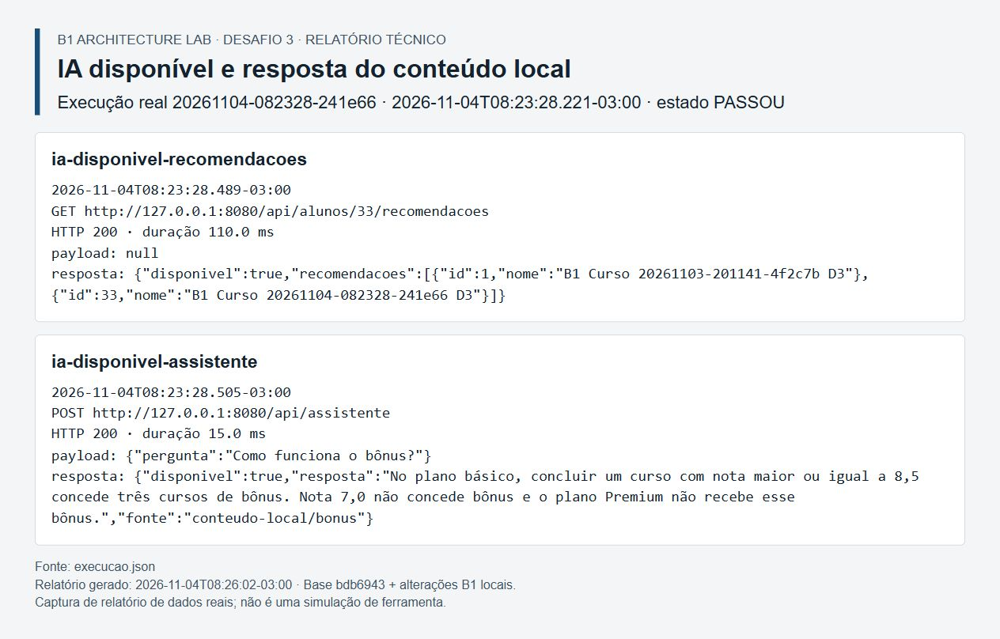
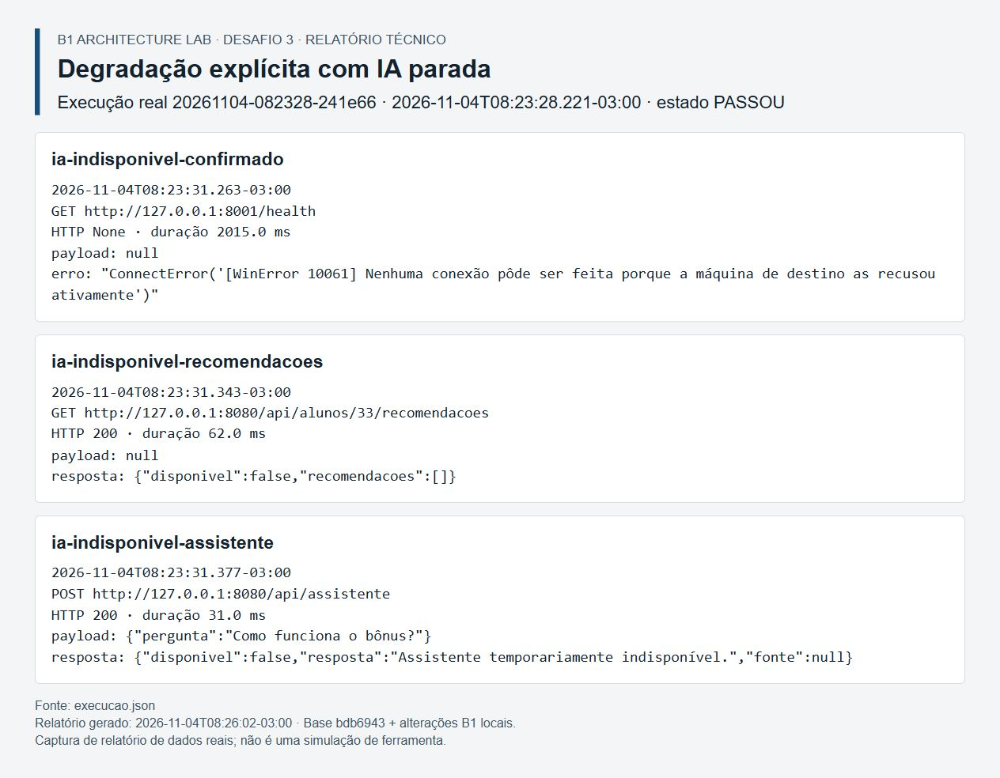
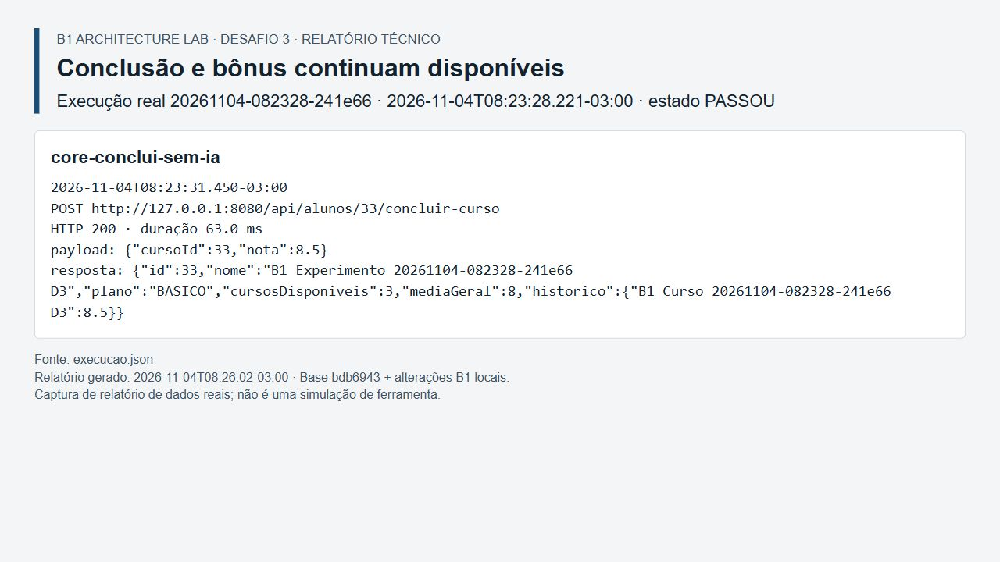

# Evidências do Desafio 3 — Serviço Python e IA

**Estado:** IMPLEMENTADO, EXPERIMENTO EXECUTADO E CAPTURAS SALVAS.

## Hipótese arquitetural

Requisições com IA ativa, IA parada e conclusão de curso mantendo recompensa e histórico.

## Execução observada

Execução `20261104-082328-241e66`: 2026-11-04T08:23:28.221-03:00 a 2026-11-04T08:23:33.316-03:00. [Respostas e comandos integrais](execucao.json).

7 verificações aprovadas. IA ativa respondeu recomendação e conteúdo local; IA parada produziu HTTP200 degradado e o Core confirmou conclusão com bônus3. Tempos medidos constam nos passos; não se trata de modelo ML ou teste de timeout lento.

Base Git: `bdb6943`, branch local `codex/b1-architecture-lab`, com alterações B1 no momento da execução. Os JSONs dos experimentos e os artefatos do Jenkins registram hashes dos fontes para identificar a implementação efetivamente testada.

## Capturas reais

### 01-ia-disponivel.jpg

Captura: 2026-11-04T08:27:19.632214-03:00. SHA-256: `f21cb8f36062dcf46a26985120970b93896bad4063d25a147a274ae7dcdd5f05`.

### 02-ia-indisponivel.jpg

Captura: 2026-11-04T08:27:20.045945-03:00. SHA-256: `dc225dd1e08fd4a41074d443ff849d960c04874c7e731f2cd7a1a318e228242d`.

### 03-core-sem-ia.jpg

Captura: 2026-11-04T08:27:20.396261-03:00. SHA-256: `727a2c1f43cdaf615e6661351142b0ce627338dac2425a043120fe595bdcc07d`.

## Fontes e reprodução

[Execução estruturada](execucao.json) e logs dos comandos em `comandos/`.

[Guia de captura e reprodução](../README.md)

[ADR-003](../../../adr/ADR-003.md) · [C4 fonte](../../../arquitetura/diagramas/ai.mmd)

## Limites

Python sozinho não prova necessidade de serviço; autonomia de ciclo e isolamento de falha justificam a fronteira aqui testada. ML/RAG compartilham o executável enquanto não há evidência de cargas/ciclos distintos. A recomendação é determinística e o assistente faz busca textual em material local, sem treinamento de ML ou RAG/LLM completo.

Os prints dos Desafios 1 a 5 mostram relatórios de dados reais preservados em texto/JSON; não simulam interface de terminal, Swagger ou IDE. Os prints do Desafio 6 mostram Jenkins e Grafana diretamente.
