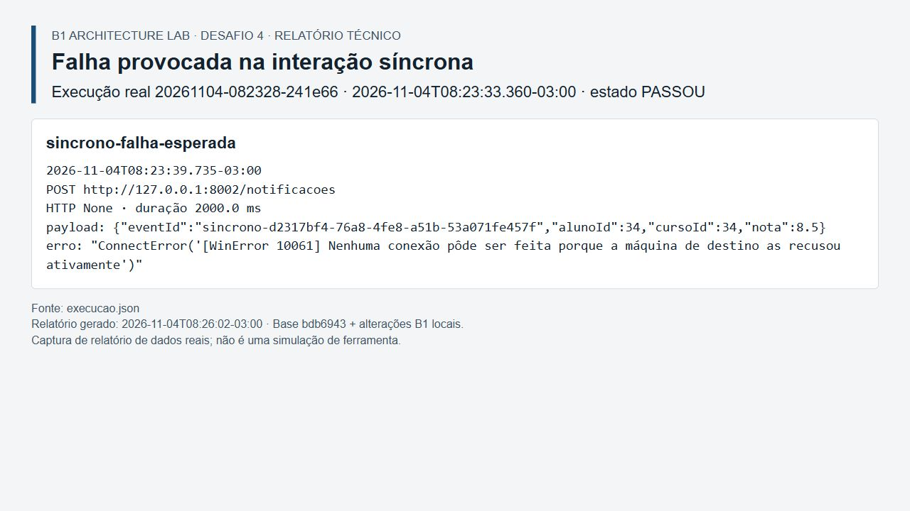
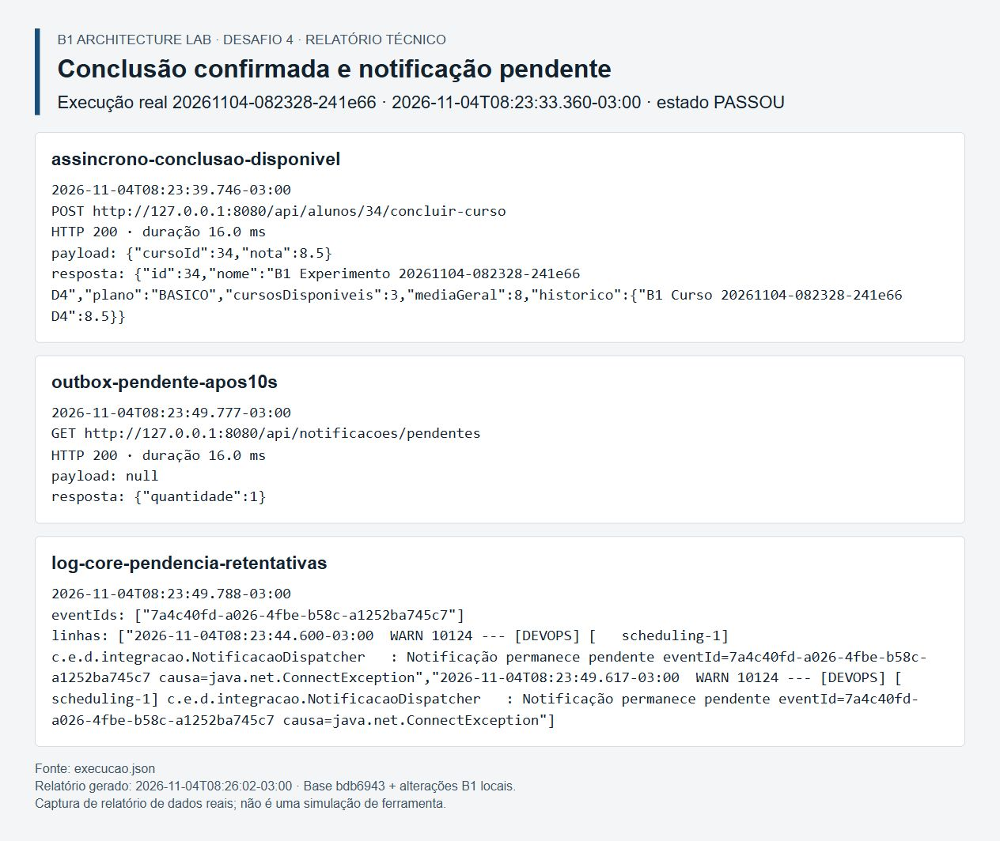
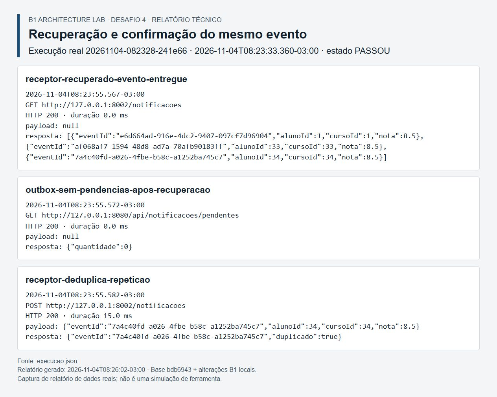

# Evidências do Desafio 4 — Comunicação e eventos

**Estado:** IMPLEMENTADO, EXPERIMENTO EXECUTADO E CAPTURAS SALVAS.

## Hipótese arquitetural

Falha síncrona provocada, conclusão HTTP 200 com evento pendente, recuperação e entrega do mesmo identificador.

## Execução observada

Execução `20261104-082328-241e66`: 2026-11-04T08:23:33.360-03:00 a 2026-11-04T08:23:55.582-03:00. [Respostas e comandos integrais](execucao.json).

9 verificações aprovadas. Com receptor parado, tentativa síncrona falhou, mas conclusão/bônus3 foram confirmados e uma pendência permaneceu por10s com retentativas do mesmo eventId. Após restauração, o mesmo identificador foi recebido uma vez, outbox esvaziou e repetição foi deduplicada. Não comprova atomicidade distribuída ou envio real de mensagem.

Base Git: `bdb6943`, branch local `codex/b1-architecture-lab`, com alterações B1 no momento da execução. Os JSONs dos experimentos e os artefatos do Jenkins registram hashes dos fontes para identificar a implementação efetivamente testada.

## Capturas reais

### 01-sincrono-falha.jpg

Captura: 2026-11-04T08:27:20.768930-03:00. SHA-256: `33b6312c9bbc3ee5b180fe2a295bb6bfe3843eb07f3184109cdfd41bb00eed8b`.

### 02-assincrono-pendente.jpg

Captura: 2026-11-04T08:27:20.987866-03:00. SHA-256: `c37f8b6d27a034b006828ba835226a9c3320767c231e9175bd8f96bf25e6557e`.

### 03-recuperacao.jpg

Captura: 2026-11-04T08:27:21.228792-03:00. SHA-256: `48fa4b32f9de42c19374ee4927d1c96e82a4dc60d24f997a70101ce7b3120412`.

## Fontes e reprodução

[Execução estruturada](execucao.json) e logs dos comandos em `comandos/`.

[Guia de captura e reprodução](../README.md)

[ADR-004](../../../adr/ADR-004.md) · [C4 fonte](../../../arquitetura/diagramas/sequence.mmd)

## Limites

Entrega pelo menos uma vez, com deduplicação no receptor; não há exatamente uma vez distribuído. Confirmação da notificação é eventual. Polling acrescenta latência e o dispatcher do laboratório é de instância única. Dados relacionais do laboratório ficam em H2 arquivo; configuração PostgreSQL permanece para Compose.

Os prints dos Desafios 1 a 5 mostram relatórios de dados reais preservados em texto/JSON; não simulam interface de terminal, Swagger ou IDE. Os prints do Desafio 6 mostram Jenkins e Grafana diretamente.
