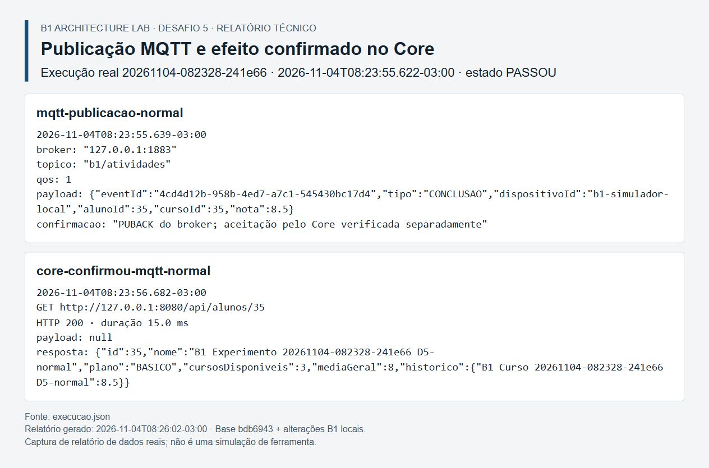
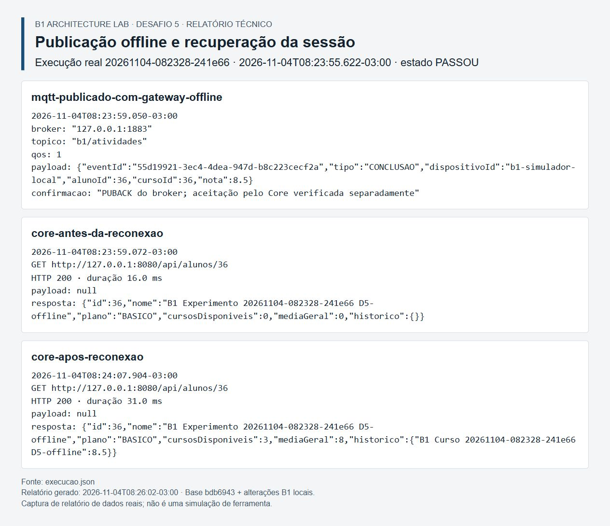
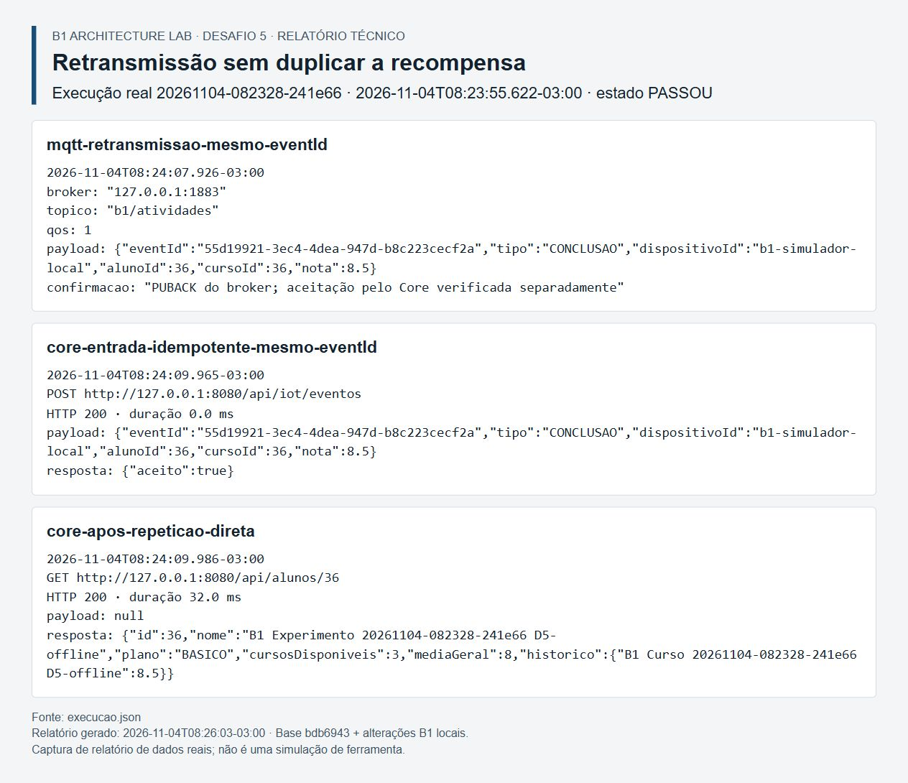

# Evidências do Desafio 5 — IoT e MQTT

**Estado:** IMPLEMENTADO, EXPERIMENTO EXECUTADO E CAPTURAS SALVAS.

## Hipótese arquitetural

Publicação/recepção com mesmo ID, publicação com gateway offline, reconexão e retransmissão sem nova recompensa.

## Execução observada

Execução `20261104-082328-241e66`: 2026-11-04T08:23:55.622-03:00 a 2026-11-04T08:24:32.660-03:00. [Respostas e comandos integrais](execucao.json).

20 verificações aprovadas. QoS1 e gateway ativo entregaram evento normal. Publicação com gateway parado não alterou o Core; após reconexão da sessão persistente, o evento foi entregue e concedeu bônus3. Retransmissão MQTT e repetição direta no Core preservaram uma conclusão e bônus3. Com Core parado, outro evento ficou PENDENTE após tentativa HTTP; gateway também foi parado e reiniciado, recuperou o spool e entregou uma vez após retorno do Core. Demonstra cenário local; não injeta queda na janela exata após commit do Core e antes do PUBACK.

Base Git: `bdb6943`, branch local `codex/b1-architecture-lab`, com alterações B1 no momento da execução. Os JSONs dos experimentos e os artefatos do Jenkins registram hashes dos fontes para identificar a implementação efetivamente testada.

## Capturas reais

### 01-mqtt-publicacao-recepcao.jpg

Captura: 2026-11-04T08:27:21.463944-03:00. SHA-256: `cbd8f839fcfc6910a4fe583a5ea1cd8533a48a56f34db9ba4416a704bd9b0eb6`.

### 02-reconexao.jpg

Captura: 2026-11-04T08:27:21.790200-03:00. SHA-256: `67fb249fd1e3d59cc7c82769ee2cec6c710952167f70922c56ff1305cacef340`.

### 03-evento-sem-duplicacao.jpg

Captura: 2026-11-04T08:27:22.040822-03:00. SHA-256: `8d3a810f3e558525fa44b650ffe8438b429e11828aef8a1eae16afd7048eba3e`.

## Fontes e reprodução

[Execução estruturada](execucao.json) e logs dos comandos em `comandos/`.

[Guia de captura e reprodução](../README.md)

[ADR-005](../../../adr/ADR-005.md) · [C4 fonte](../../../arquitetura/diagramas/iot.mmd)

## Limites

QoS 1 admite duplicatas e não substitui idempotência. O experimento prova a janela de desconexão/reconexão executada, não ausência absoluta de perdas em qualquer falha de disco. O gateway compartilha executável de integrações para reduzir operação, com responsabilidades separadas no código.

Os prints dos Desafios 1 a 5 mostram relatórios de dados reais preservados em texto/JSON; não simulam interface de terminal, Swagger ou IDE. Os prints do Desafio 6 mostram Jenkins e Grafana diretamente.
