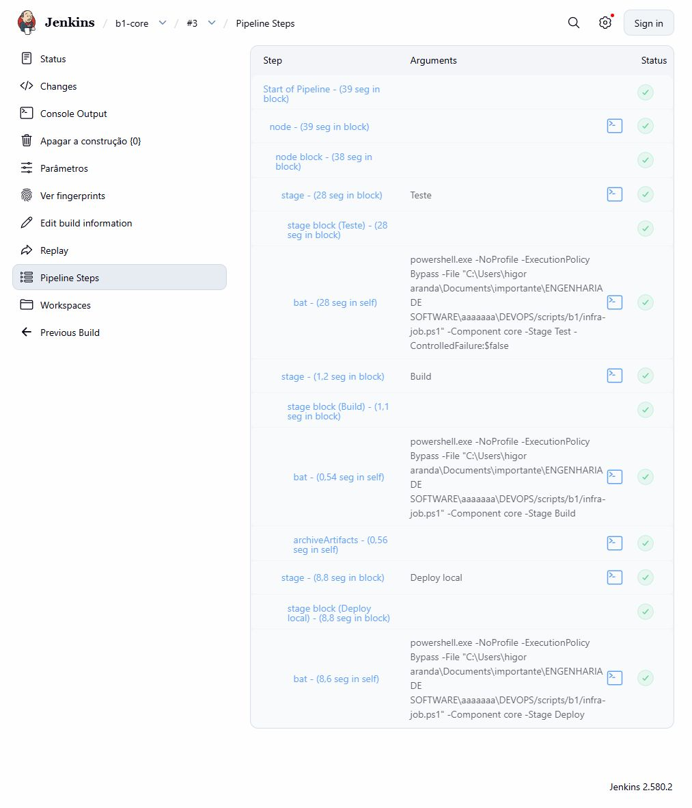
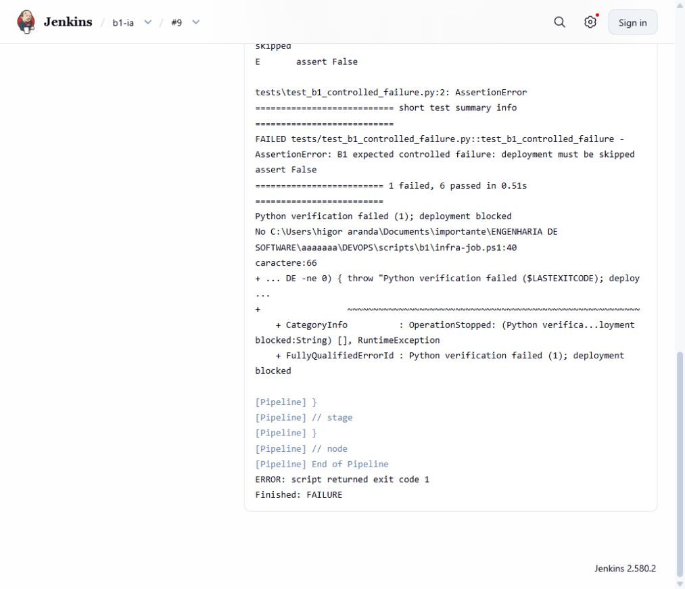
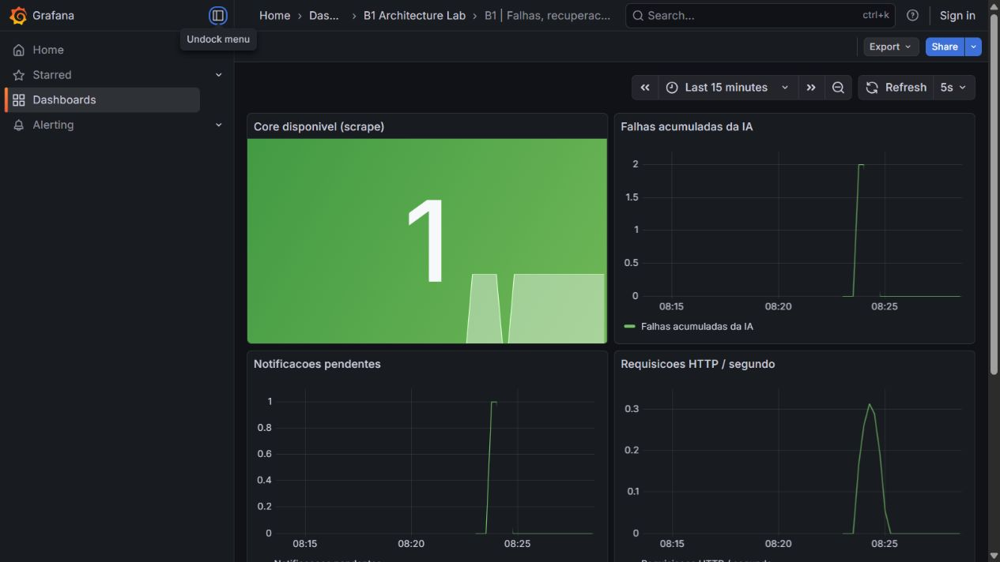

# Evidências do Desafio 6 — CI CD e observabilidade

**Estado:** IMPLEMENTADO, EXPERIMENTO EXECUTADO E CAPTURAS SALVAS.

## Hipótese arquitetural

Builds reais de três jobs, teste falho controlado bloqueando deploy, dashboard durante falha/recuperação e consultas Prometheus.

## Execução observada

Jenkins de 03/11/2026; Grafana e séries reais do experimento de 04/11/2026. Falhas acumuladas da IA variaram de 0 a 2; pendências variaram de 0 a 1 e voltaram a 0. O contador da IA reinicia quando o Core é reiniciado no Desafio 5; isso não representa apagamento das falhas por recuperação da IA.

Jenkins executou testes, build e deploy nativo: Core #3 (80 testes), IA #8 e integrações #4. IA #9 falhou por teste controlado, bloqueando build/deploy e preservando a última release aprovada.

Base Git: `bdb6943`, branch local `codex/b1-architecture-lab`, com alterações B1 no momento da execução. Os JSONs dos experimentos e os artefatos do Jenkins registram hashes dos fontes para identificar a implementação efetivamente testada.

## Capturas reais

### 01-jenkins-sucesso.jpg

Captura: 2026-11-03T20:12:37.723598-03:00. SHA-256: `c445cd2a9669549b3fffb18b999e6bc6457ee1231fa816ef86dadc10789c9d94`.

### 02-jenkins-bloqueio.jpg

Captura: 2026-11-03T20:12:47.388019-03:00. SHA-256: `f7b54c96b8629cd287ea12324b22d934df14aa53196bf064c273cd7b7932cf3e`.

### 03-grafana-falha-recuperacao.jpg

Captura: 2026-11-04T08:28:40.741689-03:00. SHA-256: `62a7322047e43f256ca382057d99b5bddf0cde6e31c63072cbfc9c9d4274753a`.

## Fontes e reprodução

[Logs, métricas e auditoria de listeners](../../../../infra/evidencias/), [pipeline Core](http://127.0.0.1:8081/job/b1-core/3/), [sucesso IA](http://127.0.0.1:8081/job/b1-ia/8/), [falha controlada IA](http://127.0.0.1:8081/job/b1-ia/9/), [sucesso integrações](http://127.0.0.1:8081/job/b1-integracoes/4/). URLs localhost exigem laboratório ativo.

[Guia de captura e reprodução](../README.md)

[ADR-006](../../../adr/ADR-006.md) · [C4 fonte](../../../arquitetura/diagramas/deployment.mmd)

## Limites

A prova foi desenhada para processos Windows portáveis, com JAR/ZIP e health check. Dockerfiles/Compose são alternativa fornecida, sem alegar execução de containers. O laboratório usa H2 relacional em arquivo; não comprova operação PostgreSQL nem escala. Métrica técnica vira evidência arquitetural quando a parada/recuperação mostra preservação do Core e drenagem da outbox.

Os prints dos Desafios 1 a 5 mostram relatórios de dados reais preservados em texto/JSON; não simulam interface de terminal, Swagger ou IDE. Os prints do Desafio 6 mostram Jenkins e Grafana diretamente.
